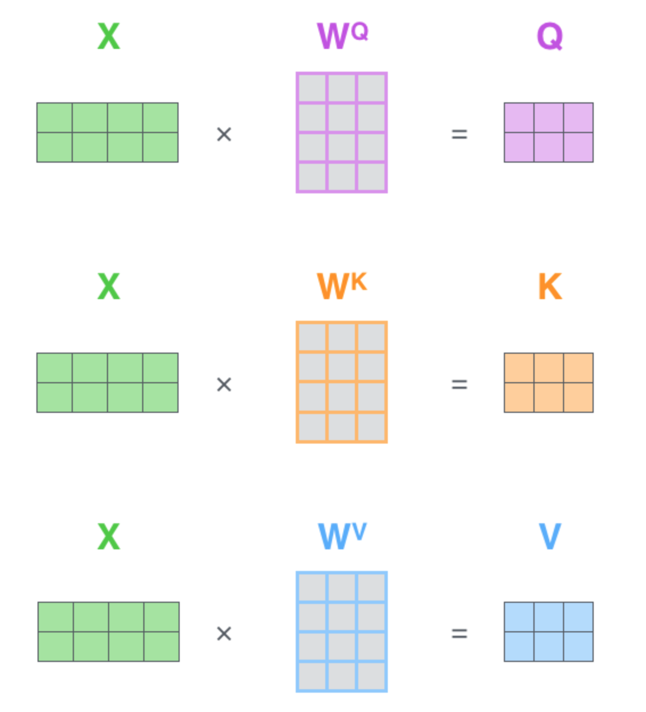
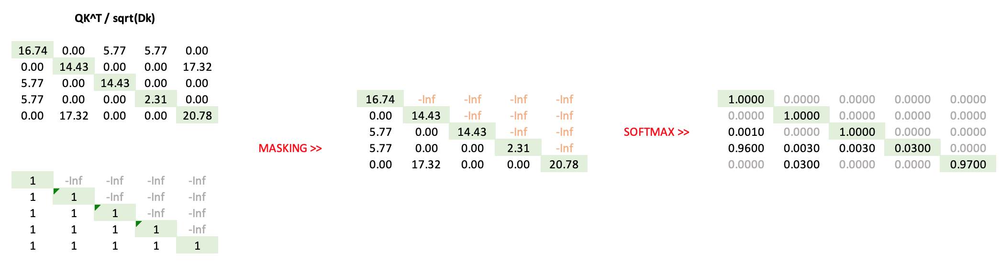
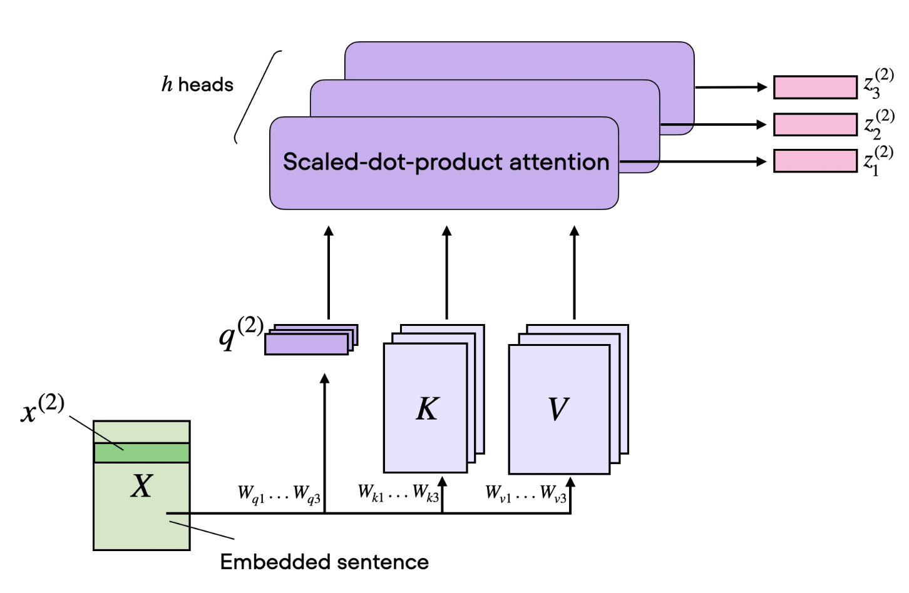
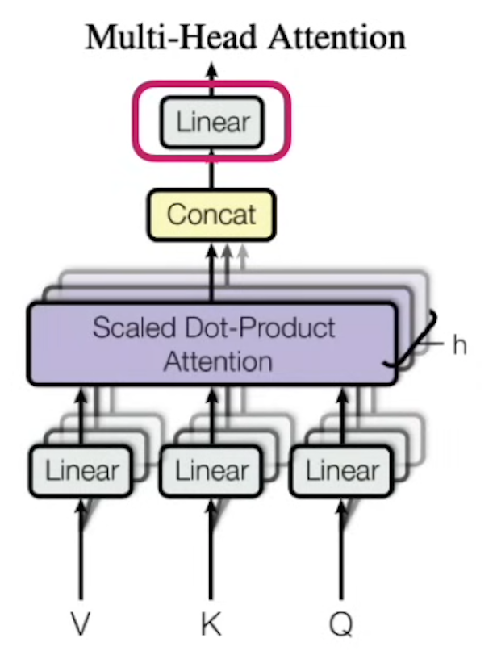

# Attention implementaion flavours

## Self-attention in real world

In the simplified example above, we calculated attention weights directly from the original embedding matrix by computing pairwise similarities between embeddings.

It might seem that there is no learning here.

However, in real Transformer implementations, three separate learnable weight matrices are introduced: W_Q, W_K, and W_V.
Q, K, V are not copied from the input embeddings X but are result of the multiplications.

Q = XW_Q,  K = XW_K,  V = XW_V

A separation of these matrices makes it possible for the model to learn word relevancy beyond the initial values we have in X. 
The initial embedding matrix X is learned separatelly (downstream before attention) in a separate embeddings layer (with positioning information).

This separation allows the model to learn three different representations of the input embeddings, each serving a specific purpose:

Q and K allow the model to learn which tokens are relevant to each other.

V allows the model to learn what information should be passed between tokens.

Q = initial embeddings x Learnable Weights Q

K = initial embeddings x Learnable Weights K

V = initial embeddings x Learnable Weights V

## Masked Attention

### Causal (Autoregressive) Attention (GPT-style)

From the previous post we can remember that we adjust each word (token) embedding to a phrase content by 
- first, calculation pairwise similarity between all words (tokens) in a phrase
- scaling and normalizing it by dividing and softmaxing
- calculate new embeddings or contextualized representations by attention formula

That is all right, with one nuance. 
One way of foundational model training in generative settings is about to predict next token based on previous tokens, but if we modify embeddings based on all words (tokens) in a sentence we kind of violate this idea. So, to be consistent at every time step we have to mask all future tokens from any future calculations, so, predicting next token we have  to only relay on the past tokens.

Here we show how to do it in computationally efficient way.

- **pairwise matrix**: First of all we need to compute pairwise dot-product similarity matrix as usial, but do not softmax it
- **create lower triangular matrix**: Create a lower triangular matrix, so later on we can use it to mask future token
- **do masking**
- **take final softmax**

### Padding Mask (Key Padding Mask) - variable length
To allow working with sequences of different length.

Lets imagine we combine a batch from two sentences
- "I love machine learning"
- "I love AI"

To make both phrases to have the same length we do padding - add a spesial PAD token to the and of second phrase.
So, in order to forbid the model to take into account those PADs, we multiply attention matrices by Padding Mask.

### Bidirectional / Full Attention 
BERT style - decoder only
Do not miss with Masked Language Modeling (MLM)

## Multihead Attention and Head Size

Remember that a simple one-head attention cottect the final embedding with respect to the relation between words in whole sentence. It does it from one point of view. 
What we can do is to take a look on the sentence from several points of view, i.e train several sets of V,K,Q matrices, so now several realtionships might be captired, for example.

Head 1: semantic relationships between Apple and Fruit.
Head 2: context relationships between Apple and Phone.

That trick is called multi-head attention. The overall schema is as follows.

Courtesy https://sebastianraschka.com/llm-architecture-gallery/mha/

But now in the output we have several embedding vectors instead of one. To compress them back to a size on one embedding we concatenate all those vectors and then use an additional linear layer (with weight matrix WO) to compress them back.  

So, the general schema of multi head attention is as follows.

But one more complication: in a real transformer a bit different contatination schema is used.
For example if we have

d_{model} = 512

num_heads = 8

Instead of having each head produce full 512 embedding vector, we can generate a smaller output called Head dimension =  512/8.
In that case the matric dimension is significantly reduced.

## implementation tricks: FlashAttention
Standard attention requires storing large intermediate matrices (like the attention scores and softmax values), which consume a lot of memory, especially for long sequences.

FlashAttention uses a memory-efficient algorithm to avoid storing these intermediate matrices, significantly reducing memory overhead.

## Cross-Attention
Cross-Attention is very similar to Self-Attention, but with one important difference: instead of calculating attention between words within the same phrase, it calculates attention between two different sequences.

For example, imagine we have two sequences: an English sentence and its French translation. When generating the French translation, each word in the decoder can attend to all words in the original English sentence. This allows the model to determine which parts of the input sentence are most relevant when generating the next word.

Technically, the main difference is that Queries (Q) come from one sequence, while Keys (K) and Values (V) come from another sequence. The Query represents what information we are looking for, while Keys and Values represent the information available from the other sequence. The attention mechanism calculates how relevant each element of the second sequence is to each element of the first sequence and uses these weights to construct new, context-aware representations.

