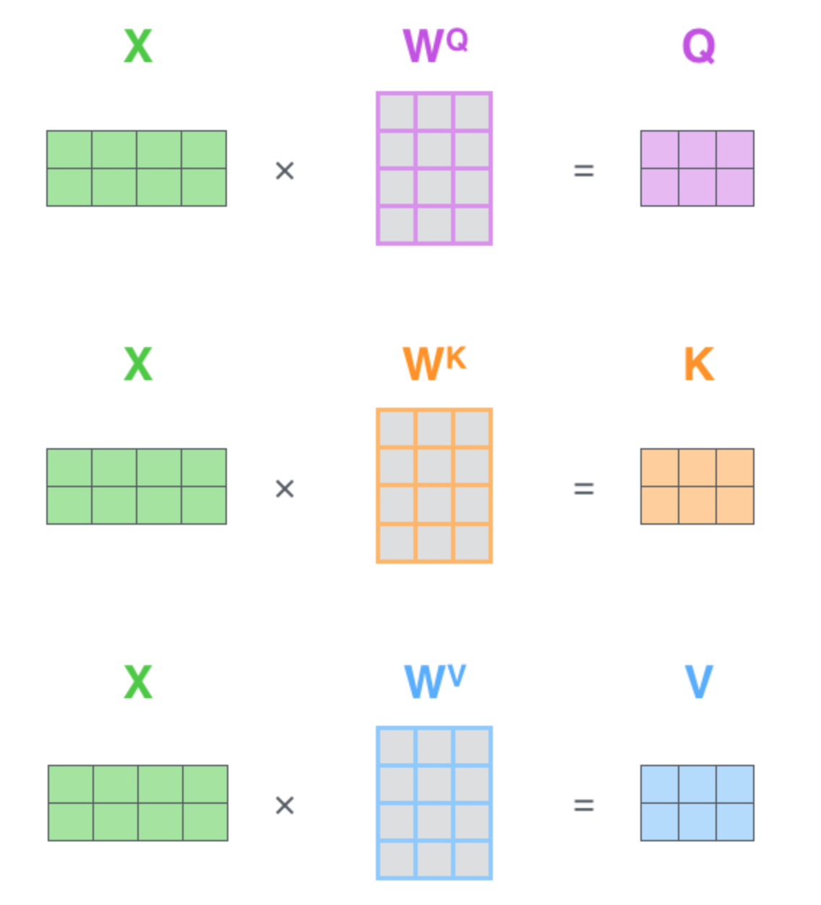
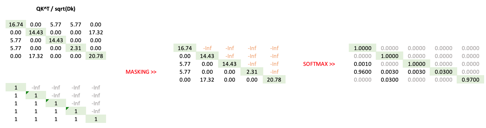

# Attention implementation flavours

## Self-attention in real world
In our previous post, we explained a simplified version of self-attention.

This version is simplified because we calculated attention weights directly from the original embedding matrix using a predefined formula.
This might give the impression that no learning takes place here.

However, in real Transformer implementations, three separate learnable weight matrices are used: W_Q, W_K, and W_V.

This means that Q, K, V are not simply copied from the input embeddings X, as they were in our simplified example, instead, they are obtained by applying separate linear transformations to X.

Q = X * W_Q,  K = X * W_K,  V = X * W_V

The process started from the initial embedding matrix X (learned first before attention calculation) and incorporates positioning information.

These three weight matrices allow the model to learn three different representations of the input embeddings, each serving a specific purpose:
- Q and K allow the model to learn which tokens are relevant to each other.
- V allows the model to learn what information should be passed between tokens.

## Cross-Attention
Cross-Attention is very similar to Self-Attention, but with one important difference: instead of calculating attention between words within the same phrase, it calculates attention between two different sequences. So we dont multiply input embedding by itself but with another embedding vector.

For example, imagine we have two sequences: an English sentence and its French translation. When generating the French translation, each word in the decoder can attend to all words in the original English sentence. This allows the model to determine which parts of the input sentence are most relevant when generating the next word.

Technically, the main difference is that Queries (Q) come from one sequence, while Keys (K) and Values (V) come from another sequence. The Query represents what information we are looking for, while Keys and Values represent the information available from the other sequence. The attention mechanism calculates how relevant each element of the second sequence is to each element of the first sequence and uses these weights to construct new, context-aware representations.

## Multihead Attention and Head Size

Remember that a simple one-head attention calculates the final embeddings with respect to the relation between words in whole sentence. It does it from one perspective only. 

Instead we can do it from several points of views, i.e to train several sets of V,K,Q matrices. Now several realtionships might be captired, for example.
- Head 1: semantic relationships between Apple and Fruit.
- Head 2: context relationships between Apple and Phone.

This approach is called multi-head attention. The overall schema is as follows.

(Courtesy https://sebastianraschka.com/llm-architecture-gallery/mha/)

However, the output now contains several embedding vectors instead of one. To combine them back to original size we concatenate all those vectors and then use an additional linear layer (with weight matrix W_O) to compress them back.  

The general structure of multi head attention is as follows.

There is one more important detail: in a real transformer a bit different approach is used.

For example if we have
- d_{model} = 512
- num_heads = 8

Instead of having each head produce full 512 dimentional embedding vector, we can generate a smaller output with *Head dimension* =  512/8. Then we just concatinate all results into final vector of 512.

This reduces the dimensions of the projection matrices and makes the computation more efficient.

## Attention Masking
In some cases, we need to prevent certain words (tokens) from interacting with others when calculating attention.
In such cases, we can use different masking strategies. 

### CLM - Causal Masking (Autoregressive)
Causal masking is commonly used in text-generation models (next-token prediction), such as GPT, LLaMA, and Mistral.

We have already learned that we have to adjust each token's representation by calculating its attention to every other token in the sentence.

That is all right, but with one important nuance. 

One way to train a foundational model in generative settings is to predict next token based on previous tokens.  However, if we modify embeddings based on all words (tokens) in a sentence we kind of knowing the future. 
In order to isolate the future from the past we have to mask out all future tokens. When predicting the next token, the model must rely only on previously available tokens.

Here is an example of how this can be implemented efficiently.

- **pairwise matrix**: First of all we need to compute pairwise dot-product similarity matrix as usial, but do not softmax it
- **create lower triangular matrix**: Create a lower triangular matrix, so later on we can use it to mask future token
- **do masking**
- **take final softmax**

### Padding Mask (Key Padding Mask) - variable length
This kind of masking allows working with sequences of different length.

Lets imagine we combine a batch from two sentences
- "I love machine learning"
- "I love AI"

To make both phrases to have the same length we do padding - add a spesial PAD token to the and of second phrase.
So, in order to forbid the model to take into account those PADs, we multiply attention matrices by Padding Mask.

### MLM: Bidirectional (Full) Attention + 
This type of masking is used in MLM (Masked Language Modeling): BERT, RoBERTa.

However, masking future tokens is not always necessary.

For example in BERT style models the goal is not to generate next token, but rather to reconstract any masked token, not the next one. For example it might be usefull during training embeddings themselves. In that case we mask a fraction of tokens (15% ) and then ask the model to reconstract them. For that reconstraction model can use all tokens and not only the past ones. 

Note that padding masks can still be applied in this setting.

### Sliding window attention and attention hierarhy
Both Causal and Full attention might be applied in a window to save on computations.

In general we can classify off types of attention as follows
- Dense Attention: Full / Bidirectional or Causal.
- Sparse Attention: Sliding Window, Dilated, Block Sparse.
- Training objectives: Autoregressive Prediction, MLM.

## implementation tricks: FlashAttention
Standard attention requires storing large intermediate matrices (like the attention scores and softmax values), which consume a lot of memory, especially for long sequences.

FlashAttention uses a memory-efficient algorithm to avoid storing these intermediate matrices, significantly reducing memory overhead.

